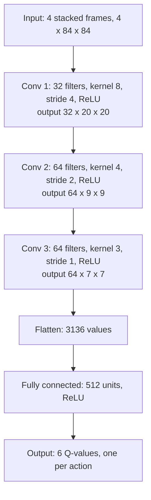
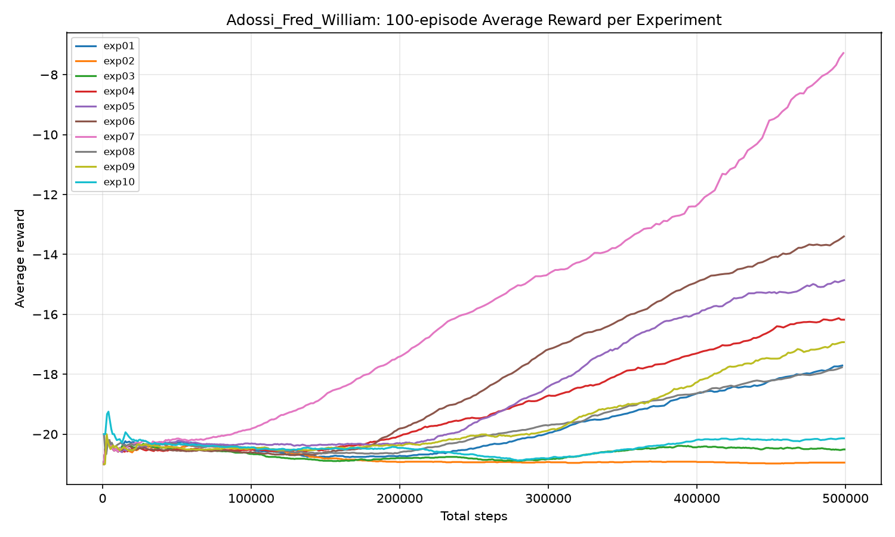
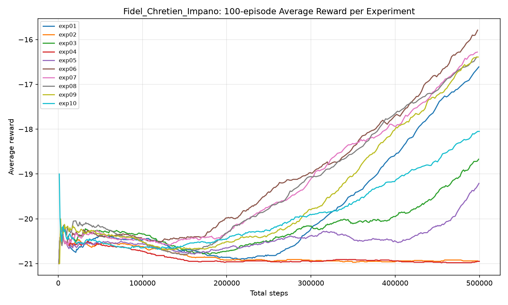
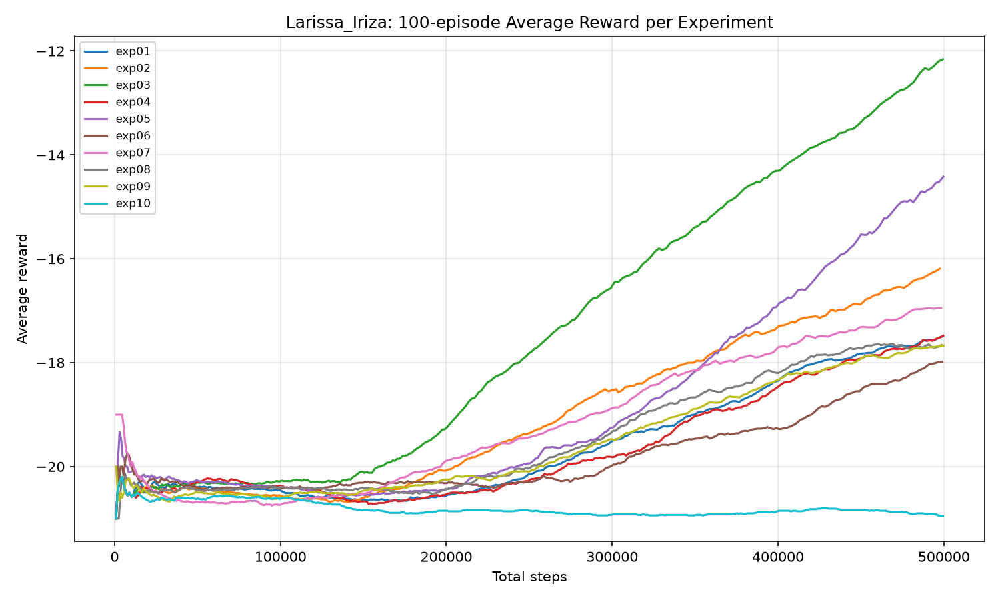
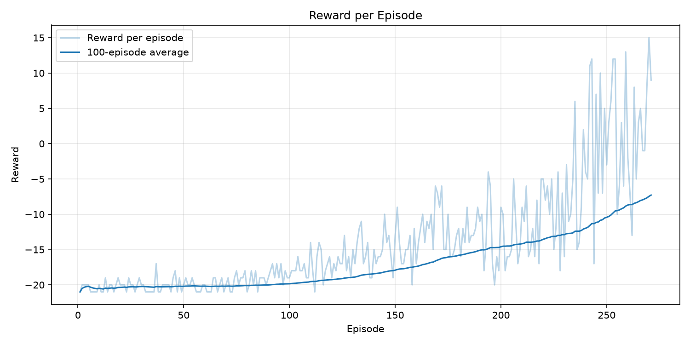
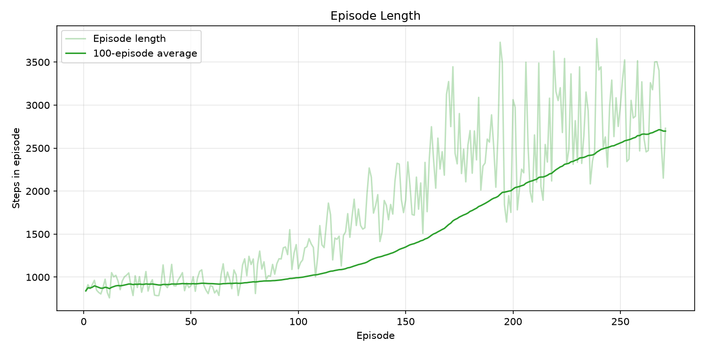
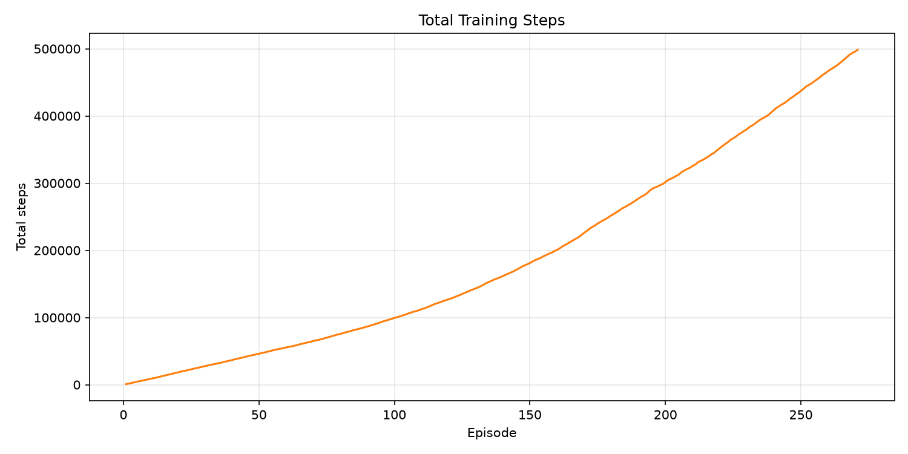

# Deep Q-Network Pong Agent (Group 10)

## Project Introduction

This is our group project for Machine Learning Techniques II at African Leadership University. In this project, we built a Deep Q-Network from scratch with PyTorch and Gymnasium and then trained it to play Atari Pong. Since we did not use any ready-made reinforcement learning library or pretrained model, our agent starts out knowing nothing about the game, and everything it learns comes only from what it sees on the screen and from the score.

To understand what the agent has to learn, it helps to look at the game first. In Pong, each player controls a paddle and tries to hit the ball past the other player. Our agent plays the green paddle on the right against the computer, and it receives +1 every time it wins a point and -1 every time it loses one. Because a game ends when one side reaches 21 points, the final score of a game always falls between -21 and +21. When we first let an agent press random buttons, it lost 21 to 2, so that became our starting point. After training, however, our best agent was able to win some of its games against the computer.

## Group Members

- Adossi Fred William
- Fidel Chrétien Impano
- Larissa Iriza

## Selected Environment

For this project, we used the ALE/Pong-v5 environment from Gymnasium and the Arcade Learning Environment, which is described on the [ALE Pong page](https://ale.farama.org/environments/pong/). In this environment, the agent chooses between 6 actions at every step, such as moving the paddle up, moving it down or keeping it still.

However, the raw game screen is a 210 by 160 colour image, and that is a lot of information for a network to process at every step. For this reason, we turn each frame into grayscale and shrink it to 84 by 84 pixels before the agent sees it. Even then, a single frame cannot show which way the ball is moving, so we stack the last 4 frames together, which gives the agent an input of shape 4 by 84 by 84. In addition, the agent picks a new action every 4 frames instead of every frame, which makes training much faster while still giving it enough control over the paddle.

## DQN Architecture



As the diagram shows, our Q-network takes the 4 stacked frames as input and gives back one number for each action, which is called its Q-value. This Q-value is the network's guess of how much reward the agent will collect if it takes that action now and keeps playing well afterwards. To produce these values, the three convolution layers first learn to recognise things like the ball and the paddles and how they move, and the fully connected layers then turn that information into the 6 Q-values. As a result, whenever the agent is not exploring, it simply plays the action with the highest Q-value.

In practice, we keep two copies of this network instead of one. The first copy, called the online network, is the one that plays the game and learns at every update. The second copy, called the target network, is only used to calculate the training targets, and it receives a fresh copy of the online network's weights every 1,000 steps. We need this second network because the targets themselves are calculated from Q-values. If the same network produced both its predictions and its targets, the targets would change every time the network learned, and training would end up chasing a goal that keeps moving.

## Training Process

At the beginning of training, the agent has no idea what any action does, so it first needs to try things out. To handle this, we use epsilon-greedy action selection, where epsilon is the chance that the agent takes a random action instead of its best one. Epsilon starts at 1.0, which means every move is random at first, and then it goes down in a straight line until it reaches a small value such as 0.01. In this way, the agent explores a lot while it still knows nothing and then slowly starts to trust what it has learned.

While the agent plays, every step it takes is saved in a replay buffer that holds the last 50,000 steps. Each of these memories keeps the frames before and after the move, the action taken, the reward received and whether the game ended at that point. Once the buffer contains 10,000 steps, the agent starts learning from a random batch of these memories every 4 steps. We choose the memories at random because frames that come right after each other look almost identical, so learning from them in order would push the network too far in one direction.

For each memory in the batch, we then calculate a target using the Bellman equation. This target is the reward the agent received plus gamma times the best Q-value of the next state, which comes from the target network. Here, gamma decides how much the agent cares about future rewards compared with the reward it gets right away. When the game ended at that step, there is no future left, so the target is simply the reward itself. After that, we compare the online network's prediction with this target using the Huber loss, which does not overreact to very large errors, and we update the weights with the Adam optimizer. On top of this, we clip the gradients so that one unusual batch cannot change the network too much at once.

All of these steps are written in [train.py](train.py). Because every hyperparameter can be set from the command line, we were able to run many different experiments without ever changing the code.

## Hyperparameter Experiments

To find out which settings matter most, each of us ran 10 experiments, which gave us 30 experiments in total. All of us started from the same baseline, which used a learning rate of 0.0001, a gamma of 0.99, a batch size of 32 and an epsilon going from 1.0 to 0.01 over 100,000 steps. In every experiment, we then changed only one of these values. Thanks to this, whenever a run did better or worse than the baseline, we knew exactly which setting had caused the difference. To keep the comparison fair, every run also trained for 500,000 steps with the same seed.

However, running 30 experiments of 500,000 steps on our own laptops would have taken far too long. Instead, we used Kaggle notebooks with two T4 GPUs. These notebooks only installed uv, cloned this repository and ran train.py with different arguments, which means the code that produced our results is exactly the code in this repository. Since our network is small and only uses part of a GPU, we ran three or four experiments side by side to save time. Even so, each experiment was a separate process with its own replay buffer and log, so running them together did not change their results.

During the week we trained, Fidel was not available, and with the deadline getting close, Adossi Fred William ran Fidel's 10 experiments for him using the settings from his plan. The full table of each member, together with what we observed in every run, can be found in the files below.

- [Adossi Fred William](Adossi_Fred_William_Hyperparameter_experiment_results.md)
- [Fidel Chrétien Impano](Fidel_Chretien_Impano_Hyperparameter_experiment_results.md)
- [Larissa Iriza](Larissa_Iriza_Hyperparameter_experiment_results.md)

The first chart shows Adossi's experiments, which covered all six hyperparameters.



Next, Fidel's experiments looked more closely at the learning rate and the batch size.



Finally, Larissa's experiments focused on gamma and the epsilon settings.



To bring the three sets of experiments together, the table below shows the best and the worst run of each member, based on the average reward over the last 100 episodes of each run.

| Member | Best run | Average reward | Worst run | Average reward |
|---|---|---|---|---|
| Adossi Fred William | Experiment 7, batch size 128 | -7.28 | Experiment 2, learning rate 0.0005 | -20.95 |
| Fidel Chrétien Impano | Experiment 6, batch size 48 | -15.79 | Experiments 2 and 4, learning rates 0.00025 and 0.001 | -20.95 |
| Larissa Iriza | Experiment 3, gamma 0.98 | -12.16 | Experiment 10, learning rate 0.0002 | -20.95 |

Looking at the table, the clearest lesson is how sensitive DQN is to the learning rate. Every run with a learning rate of 0.0002 or higher failed and stayed stuck near -21 for the whole run. On the other hand, a learning rate that was too low learned so slowly that it barely improved within 500,000 steps. Once the learning rate was right, the batch size made the biggest difference. When we increased it from 32 to 64 and then to 128, the updates became smoother, and the batch of 128 started learning earlier and climbed faster than any other run. In comparison, a slightly lower gamma helped only a little, and most of the epsilon settings changed very little, unless epsilon took so long to fall that the agent spent most of its training playing randomly.

We also noticed that our three baseline runs did not end with exactly the same score, even though they used the same settings and seed. Instead, they finished at -17.71, -16.61 and -17.49, most likely because calculations on a GPU are not perfectly repeatable from one run to the next. This showed us that a difference of about one point between two runs can simply come from luck, so we only trusted the bigger gaps when drawing our conclusions.

## Gameplay Demonstration

Based on these results, we chose Adossi's experiment 7 as our final model. This run used a learning rate of 0.0001, a gamma of 0.99, a batch size of 128 and an epsilon falling from 1.0 to 0.01 over 100,000 steps. Because it was the best of all 30 runs, we saved it as dqn_model.pth, and the plots below come from its training log.

In the first plot, the reward stays close to -21 at the start and then keeps climbing until the end of training, where it reaches an average of -7.28 over the last 100 episodes. Along the way, the agent's best game during training was a +15 win.



At the same time, the games became longer as the agent improved. A longer game means that the agent was returning the ball more often instead of losing points quickly.



Finally, this plot shows how many training steps had passed by the end of each episode.



After training, we tested the final model with play.py, where it always picks its best action and never makes random moves. In this setting, it played much closer to the computer than it did during training, with an average score of -1.0 over 3 test games, and it even won one of them.

We also recorded one full game of the final model, and in it our agent beat the computer 21 to 14. You can watch it here: [Gameplay video on Google Drive](https://drive.google.com/file/d/1x8RCWrLa0vlj4b8gIWCstUL4ggU_z64H/view?usp=sharing)

## How to Run

Since the project uses [uv](https://docs.astral.sh/uv/) to manage Python and its packages, you first need to install uv. Once uv is installed, clone the repository and install everything from uv.lock, which gives you exactly the same package versions that we used.

```bash
git clone https://github.com/Adossi-design/deep-q-network-pong-agent.git
cd deep-q-network-pong-agent
uv sync
```

After that, you can train an agent with the baseline settings by running train.py, which saves the model and a log file when it finishes. If you want to try different settings, you can change any hyperparameter with its flag, as shown in the second command.

```bash
uv run train.py
uv run train.py --batch-size 128 --out models/my_run
```

Once a model is saved, you can watch the agent play Pong in a window by running play.py. By default it loads the final model, but you can also point it to any other saved model.

```bash
uv run play.py
uv run play.py --model models/Adossi_Fred_William/exp07.pth --episodes 3
```

Lastly, you can turn any training log into plots with plot_results.py. If you give it a single log file, it draws the reward, episode length and step plots, and if you give it a member's folder instead, it draws the comparison chart of that member's 10 experiments.

```bash
uv run plot_results.py models/Adossi_Fred_William/exp07_log.csv plots/final
uv run plot_results.py models/Adossi_Fred_William plots/Adossi_Fred_William
```
